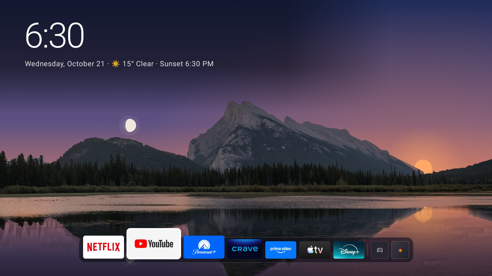
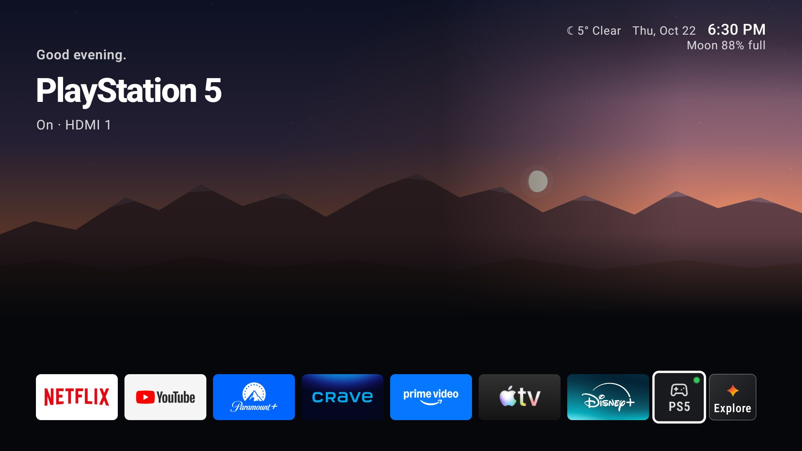
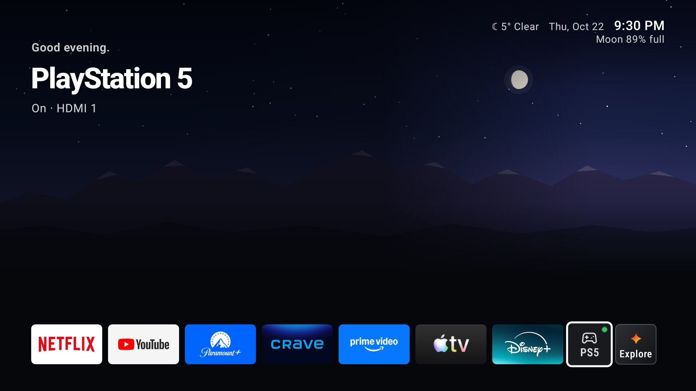
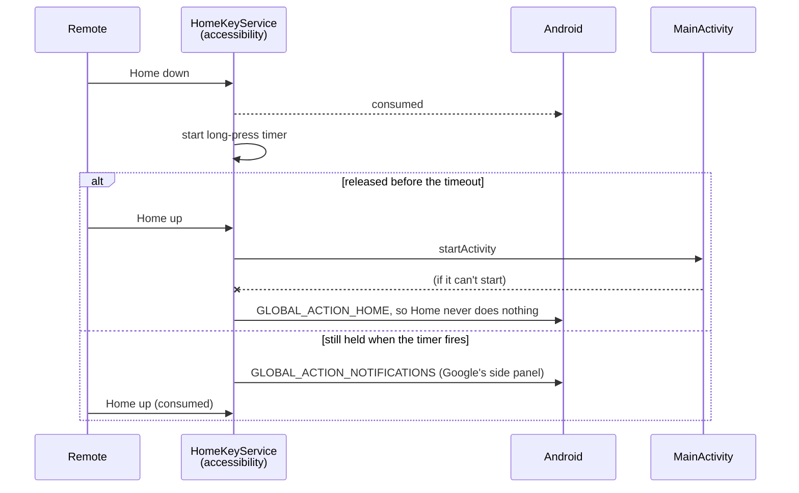

# Living Room

[](https://github.com/Aidenkopec/living-room-tv/actions/workflows/ci.yml)

A replacement home screen for my TV: a 2021 Hisense Google TV with Android 12, a 32-bit ARM chip and about 1.8 GB of RAM. It's written in Kotlin with Jetpack Compose for TV.

It does four main things:

- **Takes over the remote's Home button** without replacing Google's launcher.
- **Paints Calgary's real sky,** with the sun, moon and weather where they actually are right now.
- **Keeps a Continue watching row** built from other apps' media sessions.
- **Runs as the TV's screensaver.**



<table>
  <tr>
    <td></td>
    <td></td>
  </tr>
  <tr>
    <td align="center">Living sky at dusk, the second home screen</td>
    <td align="center">The same screen at night</td>
  </tr>
</table>

## What's interesting

**Home without being the launcher.**
- Android has one HOME app at a time. Taking that role would mean replacing Google's launcher, which on Google TV also handles accounts, recommendations and system entry points.
- Instead, an accessibility service filters key events. It consumes `KEYCODE_HOME` and opens Living Room when the button is released. A long press opens Google's side panel instead.
- It fails safe:
  - If the activity can't start, the service falls back to `GLOBAL_ACTION_HOME`.
  - If the service is off (switched off in Settings, or by Android after a force-stop), the TV behaves exactly as it did out of the box.

**A real sky on a weak GPU.**
- Sources:
  - **Sun:** NOAA's solar equations.
  - **Moon:** Meeus's low-precision series, checked against the US Naval Observatory's tables.
  - **Weather:** Open-Meteo.
- Drawing full-screen gradients every frame was too slow on this GPU. So each minute's sky is painted once, off the main thread, into a single bitmap, and that bitmap is drawn as is.
- On the dock screen, a real photo of Mount Rundle sits over that sky:
  - an offline tool (`launcher/photoprep`) cuts away the photo's own sky;
  - the app re-lights the land for the sun's height;
  - the lake mirrors the live sky row by row.

**Smooth with 1.8 GB.**
- The dock's tiles are laid out once, at their largest size. After that they're only scaled and moved in the draw phase (`graphicsLayer`), driven by one animated focus value; resizing them on every frame dropped frames.
- Memory is measured on the TV, with every reading kept in the change log: 51–60 MB while showing, against an 80 MB budget.

**Continue watching without any app's cooperation.**
- A `NotificationListenerService` follows other apps' media sessions. It exists only to get access to `MediaSessionManager` and never reads a notification.
- Each app names its shows differently, so one pure function holds each app's rule for turning session metadata into a card.
- Picking a card resumes the show the best way that app allows:
  1. press play on its paused session;
  2. deep-link to the episode;
  3. search for it;
  4. open the app.

**Decisions you can test without a TV.**
- Every decision lives in a pure function: focus rules, title fitting, sun and moon positions, which sky to show, file formats, test-switch parsing.
- About 370 JVM unit tests cover them, and the Android code around them stays thin.

**Every change to the TV is reversible.**
- The TV itself was cleaned up too: unused apps removed, tracking turned off.
- [The change log](docs/tv-change-log.md) lists 76 changes, each with its exact command and its exact undo.
- `scripts/restore-tv.sh` puts all of it back on this TV, and is tested against a fake `adb`.

## How I built it

I designed Living Room and made the calls:
- what it does;
- what the TV must never lose (HDMI inputs, casting, AirPlay, YouTube Premium, renting, system updates);
- which trade-offs to accept.

I checked every build on the TV before moving on.

Claude Code, Anthropic's coding agent, wrote most of the code. It worked from [a written spec](docs/spec.md) and a step-by-step plan for each milestone, each of which I approved before work started. [`CLAUDE.md`](CLAUDE.md) is the guide it worked from. The spec marks which decisions were mine and which were its suggestions.

## How it works



The rest is in [docs/architecture.md](docs/architecture.md): components, the Home race with Google's launcher, the render budget, storage, and how it's tested.

## Build and run

You need JDK 21 and the Android SDK. Point `JAVA_HOME` at the JDK and `ANDROID_HOME` at the SDK (or put `sdk.dir=<path>` in `launcher/local.properties`), then:

```sh
cd launcher
./gradlew spotlessCheck detekt :photoprep:test :app:testDebugUnitTest :app:lintRelease :app:assembleRelease
```

**Photos (optional).** They're never committed; the scripts download them from Wikimedia and check each one's SHA-1. They're macOS only, because they use `sips`.
- `scripts/fetch-screensaver-photos.sh`: the screensaver's 61 photos.
- `scripts/fetch-home-photo.sh`: Mount Rundle, plus its sky mask.

Without them, the screensaver shows only the painted sky, and the dock screen shows painted ridges.

**Install** on a TV with network ADB turned on. `$TV` is the TV's address, for example `<address>:5555`:

```sh
echo "$TV" > .tv            # read by the scripts in scripts/; git-ignored
adb connect "$TV"
adb -s "$TV" install -r launcher/app/build/outputs/apk/release/app-release.apk

# The Home button, Continue watching, "Last opened", and the screensaver:
adb -s "$TV" shell settings put secure enabled_accessibility_services tv.livingroom.home/tv.livingroom.home.HomeKeyService
adb -s "$TV" shell settings put secure accessibility_enabled 1
adb -s "$TV" shell cmd notification allow_listener tv.livingroom.home/tv.livingroom.home.NowPlayingListener
adb -s "$TV" shell appops set tv.livingroom.home GET_USAGE_STATS allow
adb -s "$TV" shell settings put secure screensaver_components tv.livingroom.home/tv.livingroom.home.ScreensaverService
```

To undo it, uninstall the app, which also takes back its notification and usage access, then put back the two settings it replaced. The values below are this TV's stock ones; note yours before installing, especially if another accessibility service is on:

```sh
adb -s "$TV" uninstall tv.livingroom.home
adb -s "$TV" shell settings delete secure enabled_accessibility_services
adb -s "$TV" shell settings put secure accessibility_enabled 0
adb -s "$TV" shell settings put secure screensaver_components com.google.android.apps.tv.dreamx/.service.Backdrop
```

`scripts/restore-tv.sh` is different: it puts back this TV's whole clean-up (apps, settings and Living Room), so don't run it with `--apply` on another TV.

**Test switches** show the screen at a chosen time, weather or layout. They go through `TestSwitchActivity`. That activity requires `android.permission.DUMP`, which `adb shell` holds and ordinary apps can't get, so in practice only adb can use them:

```sh
adb -s "$TV" shell am start -n tv.livingroom.home/.TestSwitchActivity \
    --es tv.livingroom.home.AT 18:30 --ei tv.livingroom.home.WEATHER 73 --es tv.livingroom.home.LAYOUT dock
```

The switches:

| Switch | What it does |
|---|---|
| `HOUR` | The screen as if it were that hour. |
| `AT` | The screen as if it were that time, with the clock standing still. |
| `WEATHER` | Puts an Open-Meteo weather code in the sky. |
| `SAMPLE_SHOWS` | Shows that many placeholder shows instead of the real ones (Living sky only). |
| `LAYOUT` | `dock` or `sky`. |
| `SAVER_AT` | Opens a screensaver preview at that time. The three switches below work only alongside it. |
| `SAVER_WEATHER` | Weather for the preview. |
| `SAVER_OFF_MIN` | Minutes until the late-night turn-off. |
| `SAVER_NEXT` | Gives the time and turn-off to the next real screensaver instead of opening a preview (the weather isn't carried over). |

## Repository

| Path | What's there |
|---|---|
| `launcher/app` | The app. Pure logic and its tests are grouped by feature (`sky`, `watch`, `apps`, `dock`, `livingsky`, `screensaver`, …). The Android components named in the manifest sit in the root package. |
| `launcher/photoprep` | A JVM tool, run on the Mac, that makes the home photo's sky mask. |
| `scripts/` | TV scripts, all reading the address from `TV=` or `.tv`. See the table below. |
| `docs/spec.md` | The design: goals, things it deliberately doesn't do, and each decision and who made it. |
| `docs/tv-change-log.md` | Every change made to the TV, in order, with its undo and the checks that followed. |
| `docs/architecture.md` | How the app is put together. |

The scripts:

| Script | What it does |
|---|---|
| `check-tv.sh` | The checks run after every change. |
| `restore-tv.sh` | Puts this TV back to stock. |
| `press-home.sh` | Presses Home through a virtual HID remote, because `input keyevent` bypasses accessibility services on this TV. |
| `tv-memory.sh` | Takes a memory reading. |
| `check-public.sh` | Fails if a private detail gets into the repo. |
| The photo fetchers | Download the photos described above. |

## Trade-offs, on purpose

- **One TV, one city, English only.** The location lives in [`HomePlace.kt`](launcher/app/src/main/java/tv/livingroom/home/HomePlace.kt). Most text is in Kotlin rather than `strings.xml`.
- **No ViewModels.** Each screen's state lives in its activity and in remembered Compose state. That's enough for a single-screen launcher that's rebuilt on every Home press.
- **Sideloaded and signed with a debug key.** An accessibility service that captures the Home key would never pass Play review, and this app is never meant to be published there.
- **The Home race.** On a Home press, Android also starts Google's launcher on its own, about 100 ms after the key goes down. Living Room usually starts 20–60 ms after that and wins. Rarely, Google's launcher restarts itself and stays on screen. This is documented, not hidden: see [docs/architecture.md](docs/architecture.md).

## Credits

- **Screensaver photos:** 61 photos from Wikimedia Commons. Each one's author and licence (CC BY-SA, CC BY, CC0 or public domain) is in [docs/screensaver-images.md](docs/screensaver-images.md) and in the app's Settings. The screensaver names each photo's place on screen.
- **Mount Rundle photo:** DXR, CC BY-SA 4.0, via Wikimedia Commons. It's cropped, its sky is replaced, and its colours change with the time of day. Screenshots that show it are adaptations, so they're CC BY-SA 4.0 too.
- **Game controller icon:** Lucide ("gamepad-2"), ISC licence.
- **Weather:** Open-Meteo.

## Licence

The code is under the [MIT licence](LICENSE). The photos aren't in this repository and keep their own licences.
